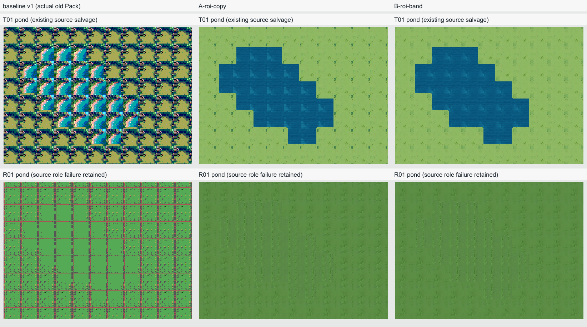

# 步骤09美术质量：现有素材离线诊断与静态小样

2026-10-18（America/Chicago）。本轮只用已保存的T01/R01素材定位问题、固定两组离线实验并交付静态对照；**0供应商请求、0新增付费、0真实密钥读取**。不切换生产默认Prompt/模型/`normalizeAiTerrain v1`，不改Compiler/Profile/Pixel Contract，不覆盖任务、转换、Pack、预算或MZ历史，不进入10。

**结论：T01的可辨识性明显改善，仍未达到可直接宣布适合铺设的质量；R01离线修复水面失败。** 原“water”就是草地/道路，去掉格网不会变成水。小样仅证明从现有T01中经一次Agent人工ROI选择可以抢救材质，不是默认零辅助、自动选区或零人工整套能力已经完成。没有新增美术评分或降低要求。

## 一眼对照与产物



列：原实际Pack基线、A（ROI+共享自适应64色+旧单行对边拷贝）、B（同ROI/同调色板，仅改4逻辑像素成对边带融合）。行：T01、R01。全部为实际导出A1/A2重新解码后渲染的同一池塘、源状态0、1×；不是源纹理拼贴或另画的新地图。

- [T01原图/固定ROI/转换源](../evidence/step-09/art-offline/T01-sources-comparison.png) · [T01池塘](../evidence/step-09/art-offline/T01-pond-comparison.png) · [T01六场景](../evidence/step-09/art-offline/T01-scenes-comparison.png)
- [R01原图/原参考/准备图/转换源](../evidence/step-09/art-offline/R01-sources-comparison.png) · [R01池塘](../evidence/step-09/art-offline/R01-pond-comparison.png) · [R01六场景](../evidence/step-09/art-offline/R01-scenes-comparison.png)

六场景分别为池塘、长直边/角、孔洞、细道、大片铺设和孤格；同拓扑/缩放/状态逐列比较。完整不可覆盖输出位于`.local/step09-art-offline/run-0086d8805fb4/`，各Case下`A-roi-copy/`、`B-roi-band/`都是经过严格重读验证的标准8文件Pack；各配置另有`*-static-states.png`及源状态0/1/2地图，**静态差异不代表动画自然或MZ实机通过**。

实验工具source：`0086d8805fb431c0446de5a4471859bc8d322dba`，基线`f61348049551c13c9eb3e17c81806e00470c2cf5`，分支`codex/step-09-ai-studio`。后续仅文档/证据提交不改小样。所有新Pack、图集、输入/输出像素Hash及参数见[summary](../evidence/step-09/art-offline/summary.json)，关键PNG与旧产物哈希见[artifact-hashes](../evidence/step-09/art-offline/artifact-hashes.json)。

## 原因：证实、因果与假设分开

| 层级            | 直接证据与结论                                                                                                                                             | 证据边界                                                                                                                                                          |
| --------------- | ---------------------------------------------------------------------------------------------------------------------------------------------------------- | ----------------------------------------------------------------------------------------------------------------------------------------------------------------- |
| 生成内容：T01   | 原草地图已有屋顶、树丛、强明暗和场景边缘；原水图是岩石/沙滩/海岸/深浅水场景。整图不是均匀材质。旧转换把这些大轮廓压成一个48px单元后重复，形成孤岛/海岸边框 | 能直接看到本批输出不服从既有“no scene/objects”约束；不能据一批断言模型一般能力，也不能证明某一句Prompt单独造成失败                                                |
| 参考与生成：R01 | 96×144原参考本身有规则草纹竖条及横/竖线；准备图保留这些布局。实际“water”原图仍是绿色草地/道路，输入已经缺少水面语义                                        | 格线有参考来源，不能全归咎模型或转换。当前edit的“preserve material identity/stable geometry”与草地参考→水面角色有语义张力，这是待验证解释，不是已做Prompt因果实验 |
| 参考准备        | 从96×144中心裁为96×96再nearest到256×256，上下共丢48行，损失1/3面积                                                                                         | 该操作保持裁后比例，不等于保留完整参考的构图、风格和细节；本轮未新造参考准备配置                                                                                  |
| 转换内容选择    | v1整图nearest→24×24→密度2→2×3重复，保留了不应重复的建筑/岸线/道路大结构；固定ROI后这些大结构消失                                                           | 48px周期是当前单tile铺设的固有限制，重复率1本身不新增为淘汰线；应看周期内内容是否形成显眼母题                                                                     |
| 转换调色        | 同一ROI上，旧每通道2bit只余2–3色；自适应共享64色保留26–63色，平均绝对RGB误差由约17.64–18.33降至0.52–0.95                                                   | 这是同坐标的颜色损失测量，不是美术分、参考契合度或可用率。A相对旧Pack同时改ROI和调色，不能把全部视觉改善单独归给其中一个因素                                      |
| 周期连接        | A只复制一行；B在同ROI/同锁定palette下改为4逻辑像素边带融合并映射回同一palette。两者状态0端点差都可为0                                                      | 边界差0不能证明无缝；相移后的其他状态、较宽平滑边框、重复纹理和动态自然度仍需观察                                                                                 |
| 岸线            | 固定mask/几何可以保证拓扑和本套跨帧保护，却不会自动设计自然的岸边颜色/质地                                                                                 | 当前小样边界清楚但较薄、简单；颜色、阴影和质地协调尚未完成，不以“固定岸线像素0差异”替代美术判断                                                                   |

四份原任务的Prompt不是猜测：用绑定Registry、已保存的model/structured/reference记录离线重建Snapshot，**4个fingerprint均精确匹配原snapshotHash**。[原冻结内容与未执行提案](../evidence/step-09/art-offline/frozen-prompts-and-proposal.json)。R01水面确实追加了water组件描述；没有声称系统没传水面角色。实际静态renderer/源路径为`.local/step09-live-assets/objects/<SHA>`，旧文档中的`.local/step09/live/assets`不是本树真实资产root。

## 固定实验：一次选区，两个配置

[实验计划](../evidence/step-09/art-offline/experiment-plan.json)在运行前冻结。坐标均是原256×256结果中的整数`x,y,width,height`，依据原像素及一次坐标网格检查由Agent选定，未扫描多组ROI挑最好：

| Case/源     | 固定ROI       | 保留原图面积 | 选择/不可修复内容                                                  |
| ----------- | ------------- | ------------ | ------------------------------------------------------------------ |
| T01草地     | 88,84,64,64   | 6.25%        | 中央平稳草面，避屋/树/强阴影；其余93.75%舍弃，不能称整张生成已合格 |
| T01水面     | 184,176,64,64 | 6.25%        | 右下内部深水，避岸线及强浅深分界；仍带局部亮斑纹理                 |
| R01草地     | 104,132,48,48 | 3.52%        | 中央无灌木/道路区域；仍保留草纹                                    |
| R01所谓水面 | 104,112,80,80 | 9.77%        | 避道路但仍是草地；没有染蓝、替换为CC0水或借用T01水冒充修好         |

两配置均保比例nearest到24逻辑像素；同Case的草/水共同学习一份确定性weighted median-cut64色，A/B完全同palette；密度2输出96×144；三个水源状态从同一基础相移0/1/2逻辑像素派生。B仅改变边带：成对边缘在显式sRGB数值域向共同均值融合，权重1/0.75/0.5/0.25，随后量化回同一锁定palette，未扩大色数或隐式ICC转换。

B处理最多触及24×24中的55.56%边带。实际在量化前改动草/水像素：T01 **45.66%/51.22%**、R01 **43.58%/44.97%**；平均RGB改变约0.58–1.47/255。它不是免费的单线修补，可能抹掉小簇或产生宽软边框。当前T01 B比A的亮三角母题稍弱，重复仍在；未据此选择B作为生产默认。

链路保持：原候选字节/SHA→独立RGBA输入→新实验组件硬校验→既有固定岸线配方→原Compiler→原Pack→实际8文件→重新解码A1/A2→地图。原mask精确复用；新草地生成新bank颜色组件、新style/recipe，白区内从新草地取色，原bank与旧revision不变。**跨帧保护的是本新配套，未声称新配套沿用旧bank颜色。** 四新Pack共36,672次保护像素比较差异0；原Profile/槽位/Pixel Contract均不变。

## 哪些改善，哪些未达到目标

T01：草地、水面与池塘/长直边/孔洞/细道轮廓已明显可辨，旧的每格房屋/孤岛/海岸边框移除。A水面仍有规则亮三角/斑块；B更软但同单元重复仍明显，草地也有平铺痕迹。岸线是较薄的草水边界，不能据静态图确认自然过渡或动画。**仅“可抢救”得到静态证据，尚未证明整套适合实际铺设。**

R01：道路格网可以移除，结果仍整片草绿色，水面与岸线不可辨。**本批原料不足，水面离线修复失败；未达到用户目标。** 三帧即使发生像素变化，也只是草纹平移，不变成水波。

## 最小整改方案（待验证，不直接切换默认）

1. **先解决目标材质与参考语义。** 保留主Prompt主体及普通用户不选模型；把edit任务模板的新版本明确为“参考用于像素簇、光照和协调色系；目标角色允许重建，不保留道路/草地布局；water必须读作水，使用协调蓝/青次色”。本轮只输出`terrain-reference-role-edit@2-proposal`/配置提案的离线文字差异，没有执行模型、改旧快照或证明新效果。参考可另行提出版本化的中性材质区域/色板准备，但须披露裁切和损失，不把删特征说成天然保真。未来真实验证必须另核对固定输入、版本、次数和金额的明确授权。
2. **候选合格后才做转换。** 当前人工ROI仅作诊断补救，不能成为“默认零辅助自动整套已完成”的替代。后续生产候选应生成平稳、正确角色的材质，再使用独立版本的显式采样/共享自适应调色；不合适的raw或无法形成合格区域的候选应明确拒绝/待选，保留所有尝试。A/B只支持改进方向，不能靠单行端点复制或边带变软就宣称无缝。边带方案是否采用，仍需更具体的铺设/静态簇/动态检查。
3. **在既有mask内设计岸线颜色与质地。** 新bank/recipe版本与本套草水共用受限palette，在固定白区内协调草缘暗部/少量土色层次，保持几何、动态区和跨帧保护不变；明确新增颜色与依赖，硬校验不放宽。本轮不再追加第三配置，也未实现这项质地修整。

R01后续不必立即重买图片：可先选择已有技术合格水源作**显式人工组件替换**、建立新配套；若跨Case复用T01等候选，必须记录原Case/任务/源SHA，参考契合度另验，不能计成R01模型水面成功。另一选择是在角色Prompt方案获认可后，单独申请固定输入/版本/次数/金额的付费验证。本轮两种选择都只提出边界，不做跨Case第三配置，不提交预算申请或调用模型。

这三个改动都不需要改Compiler/Profile/Pixel Contract；先解决内容角色和材质采样，才有理由讨论新的受控生成或动画/岸线美术迭代。未批准正式质量阈值，未用本批结果事后降低要求，H02留集未触碰。

## 检查、历史与停止

[检查记录](../evidence/step-09/art-offline/checks.json)：新增纯实验测试4/4、root TypeScript与指定三文件ESLint通过，root CLI构建通过；固定4个实验Pack均标准8文件/来源重放/IR/Compiler/Palette/Mask/Manifest/实际PNG严格通过。原2套实际Pack的全部payload、ZIP、原任务Snapshot，以及真实approval/ledger SHA保持原样。第一轮类型错误与首次新ID大写触发`REVISION_ID`失败保留；只修工具，不删用例/改契约，ROI和两配置未变。

```sh
# 依赖/包构建已准备的本树；新环境先按既有基线install/build，勿对运行中的服务clean-build
pnpm exec tsc
pnpm exec vitest run tests/step09-art-offline.test.ts
# 需已有本机私有原素材，且工作树clean；输出目录按source命名，已存在即拒绝覆盖
pnpm experiment:step09:art
```

已只读确认[独立R1报告](/Users/dingshinn/.codex/worktrees/step-09-independent-review-r1/rpg-maker-maker/.local/step09-review/report.md)对f613候选限定技术范围PASS，441/441、完整09 4/4、原503一次、两MZ启动通过；原R09-01/02/03已由该独立复审CLOSED。旧V09原因未证实和所有失败仍保留。该独立结论不继承为本新实验的独立PASS或美术PASS，本轮不重复全局审查/DB/API/浏览器/MZ。

当前状态：**OFFLINE_EVIDENCE_READY；T01部分改善，R01失败；生产无人干预闭环美术目标尚未完成；实验未采用，人工美术/动态/MZ仍未验收，步骤09未整体通过。** 不修改用户Studio、数据库或全局MZ环境，不启动Reviewer、不批准/合并/推送或进入10。交付本轮原因、最小方案和固定静态小样后停止。
